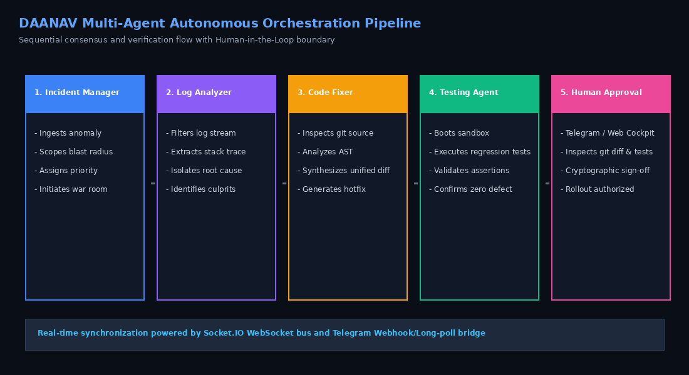

# Autonomous Agent Roles & Specification

**Project**: DevOps AI Command Center  
**Built By**: Team DAANAV  
**Hackathon**: WeMakeDevs Flip the Switch Hackathon 2026 (Track 01 — Best Business Workflow)  

In the **DevOps AI Command Center**, autonomous incident response is governed by a network of four specialized agents. Rather than relying on a single monolithic prompt, each agent adheres to strict role segregation, defined input/output schemas, and deterministic evaluation boundaries.



---

## 1. Role Matrix Overview

| Agent Role | Persona Key | Emoji | Primary Objective | Output Artifact |
| :--- | :--- | :---: | :--- | :--- |
| **Incident Manager** | `incident-manager` | 🤖 | Triage scope, estimate blast radius, define plan | `TriageReport` |
| **Log Analyzer** | `log-analyzer` | 🔍 | Telemetry correlation, error pattern mining | `LogAnalysis` |
| **Code Fixer** | `code-fixer` | 🛠️ | Root cause analysis, unified git diff generation | `CodeFix` |
| **Testing Agent** | `testing-agent` | 🧪 | Sandbox regression testing, assertion verification | `TestResult` |

---

## 2. Agent Deep Dives

### 2.1 Incident Manager Agent (`incident-manager`)

- **Purpose**: Acts as the initial orchestrator and incident commander upon anomaly detection. Evaluates the severity, estimates service blast radius, and drafts an investigation action plan.
- **Input Contract**:
  ```typescript
  interface IncidentInvestigationContext {
    incidentId: string;
    incidentKey: string;
    title: string;
    description: string;
    service: string;
    severity: "LOW" | "MEDIUM" | "HIGH" | "CRITICAL";
  }
  ```
- **Output Contract**:
  ```typescript
  interface TriageReport {
    summary: string;
    blastRadius: string;
    recommendedSeverity: string;
    plan: string[];
  }
  ```
- **Telegram Avatar**: Primary Incident Commander Bot (`🤖 Incident Manager`).
- **Heuristics & Logic**:
  - Dynamically calculates user and transaction impact percentages based on service category (`checkout-api`: high impact, `events-worker`: low impact).
  - Establishes a step-by-step remediation plan dispatching work to downstream agents.

---

### 2.2 Log Analyzer Agent (`log-analyzer`)

- **Purpose**: Consumes high-velocity raw log telemetry and isolates the exact culprit log lines, timestamps, and stack traces associated with the incident.
- **Input Contract**:
  - `IncidentInvestigationContext`
  - `LogEntry[]` (telemetry stream from distributed services)
- **Output Contract**:
  ```typescript
  interface LogAnalysis {
    matchedLogIds: string[];
    pattern: string;
    summary: string;
    culpritFile?: string;
    stackTrace?: string;
    message: string;
  }
  ```
- **Telegram Avatar**: Telemetry Analyst Bot (`🔍 Log Analyzer`).
- **Heuristics & Logic**:
  - Filters logs by target service tag and timestamp window.
  - Matches critical log levels (`CRITICAL`, `HIGH`, `500 errors`).
  - Isolates error signatures such as `TypeError: Cannot read properties of undefined` and extracts file/line coordinates (e.g. `src/checkout.ts`).

---

### 2.3 Code Fixer Agent (`code-fixer`)

- **Purpose**: Inspects codebase AST and source files, diagnoses the software bug, and synthesizes a minimal, clean, production-ready unified git diff patch.
- **Input Contract**:
  - `IncidentInvestigationContext`
  - `LogAnalysis`
- **Output Contract**:
  ```typescript
  interface CodeFix {
    summary: string;
    rootCause: string;
    file: string;
    patch: string; // Standard Unified Git Diff format
  }
  ```
- **Telegram Avatar**: Software Architect Bot (`🛠️ Code Fixer`).
- **Unified Diff Standard**:
  - Generates valid `diff --git`, `--- a/...`, `+++ b/...`, and `@@ ... @@` hunk headers.
  - Provides defensive fallback handling (e.g. guarding null/undefined objects before member access) to guarantee backwards compatibility.

---

### 2.4 Testing Agent (`testing-agent`)

- **Purpose**: Boots an isolated sandbox container or subprocess, applies the proposed patch in memory, and runs the automated unit and regression test suite.
- **Input Contract**:
  - `IncidentInvestigationContext`
  - `CodeFix`
- **Output Contract**:
  ```typescript
  interface TestResult {
    status: "PASSED" | "FAILED";
    command: string;
    durationMs: number;
    passedCount: number;
    failedCount: number;
    output: string;
    summary: string;
  }
  ```
- **Telegram Avatar**: Quality Assurance Bot (`🧪 Testing Agent`).
- **Safety Enforcement**:
  - Rejects malformed patches that fail unified diff syntax checks.
  - Validates that test suites execute without shell escaping hazards.
  - Formats TAP (Test Anything Protocol) output and triggers the Telegram Human-in-the-Loop review gate upon zero regression detection.

---

## 3. Collaborative Handshake Protocol

When an incident runs, the orchestrator facilitates sequential handshakes:

```text
IncidentManager ➔ emits TriageReport
                  │
                  ▼
LogAnalyzer     ➔ consumes TriageReport, queries telemetry ➔ emits LogAnalysis
                  │
                  ▼
CodeFixer       ➔ consumes LogAnalysis, inspects AST ➔ emits CodeFix (Unified Git Diff)
                  │
                  ▼
TestingAgent    ➔ consumes CodeFix, executes regression suite ➔ emits TestResult
                  │
                  ▼
Human Operator  ➔ receives complete dossier with actionable Approve/Reject buttons
```
