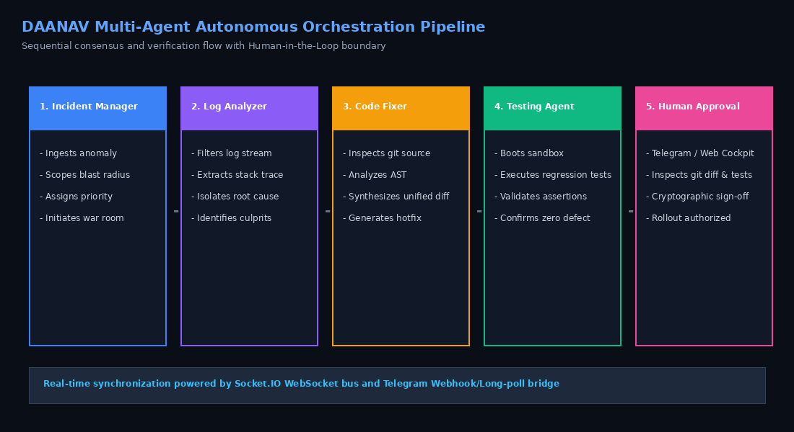
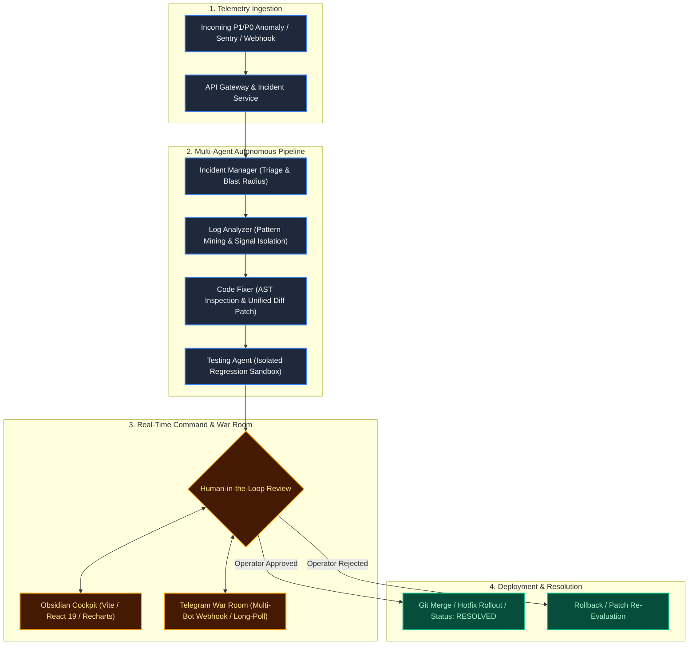
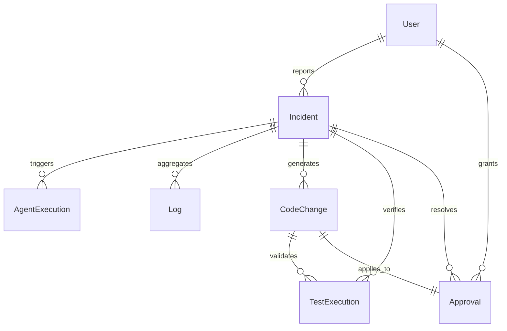

# DevOps AI Command Center — Architecture & System Design

**Project**: DevOps AI Command Center  
**Built By**: Team DAANAV  
**Hackathon**: WeMakeDevs Flip the Switch Hackathon 2026 (Track 01 — Best Business Workflow)  

The **DevOps AI Command Center** is a human-supervised autonomous incident response and remediation workspace engineered by **Team DAANAV**.



---

## 1. Executive Architecture Summary

Modern site reliability engineering suffers from alert fatigue, fragmented context across logging systems, slow manual triage, and risky unverified hotfixes. The DevOps AI Command Center solves this by coupling a sequential four-tier autonomous agent network with a deterministic human-in-the-loop (HITL) approval boundary:



---

## 2. Interactive Architecture Visualizer

- **Standalone Viewer**: [Open Archify Interactive Diagram](./devops-ai-command-center-architecture.html)
- **JSON Source Definition**: [Edit Archify Model Source](./devops-ai-command-center.architecture.json)
- **Attribution & Licenses**: [Third Party Notices](./licenses/archify/THIRD_PARTY_NOTICES.md)

---

## 3. High-Level Design (HLD)

### 3.1 Core Subsystems

| Layer | Technology | Primary Purpose |
| :--- | :--- | :--- |
| **Command Cockpit** | React 19, TypeScript, Vite, TailwindCSS v4, Recharts, Lucide | High-contrast cockpit grid, telemetry charts, real-time agent activity feed, diff inspector, and approval dock. |
| **API & Real-time Core** | Node.js 22, Express 5, Socket.IO, Zod, tsx | REST command gateway, Zod schema validation, Socket.IO event fanout, and orchestration controller. |
| **Multi-Agent Network** | TypeScript Agent Engine / Switch Agent Protocol Bridge | Sequential agent pipeline executing triage, signal isolation, patch synthesis, and test verification. |
| **Telegram War Room** | Node.js HTTPS client, Telegram Bot API | Multi-bot concurrent polling and dispatch for `Incident Manager`, `Log Analyzer`, `Code Fixer`, and `Testing Agent` with inline approval callbacks. |
| **Data Persistence** | PostgreSQL 17, Prisma ORM 6.x | Relational storage for users, incidents, executions, logs, proposed code changes, test suites, and cryptographic approvals. |
| **Sample Microservice** | Node.js ESM, TypeScript, Native Test Runner | E-commerce checkout service with reproducible concurrency and null-cart defect scenarios. |

---

## 4. Multi-Agent Pipeline Architecture

The platform avoids single-agent hallucination loops by enforcing strict role segregation and immutable data contracts between steps:

```text
Incident Created
  │
  ▼
[ Incident Manager ]  ──> Assesses severity, computes blast radius %, builds remediation runbook.
  │
  ▼
[ Log Analyzer ]      ──> Queries telemetry stream, correlates timestamps, isolates culprit stack trace.
  │
  ▼
[ Code Fixer ]        ──> Inspects repository code AST, identifies defect, synthesizes unified git diff.
  │
  ▼
[ Testing Agent ]     ──> Boots isolated test runner, executes unit/regression suite, verifies assertions.
  │
  ▼
[ Human Approval ]    ──> Operators review git diff + test proof in Web Cockpit or Telegram War Room.
  │
  ├─► [APPROVED] ──> Records signature, triggers deployment, marks incident RESOLVED.
  └─► [REJECTED] ──> Records feedback, locks branch, prevents unverified deployment.
```

---

## 5. Switch Integration Architecture

The command center interfaces with the Switch Agent Protocol via the `CompositeSwitchAdapter`:

- **Fail-Closed Strategy**: When `SWITCH_ENABLED=false`, the platform operates safely using its local high-fidelity simulation engine. It never synthesizes fake successful remote provider payloads.
- **Protocol Boundary**: When `SWITCH_ENABLED=true`, the adapter communicates with the Switch server (`/api/v1/tasks/dispatch` and `/agents/:id/message`) with full authentication headers and retry logic.
- **Failover & Resilience**: Network timeouts, remote disconnections, and malformed task responses are caught gracefully and surfaced to the UI without crashing the orchestrator.

---

## 6. Telegram War Room Dual-Channel Architecture

A dedicated multi-bot Telegram command center is integrated:

- **4 Specialized Persona Bots**:
  1. `🤖 Incident Manager`: Triage updates and severity escalation.
  2. `🔍 Log Analyzer`: Telemetry dumps and stack trace isolation.
  3. `🛠️ Code Fixer`: Unified git diff proposals with `<pre><code class="language-diff">`.
  4. `🧪 Testing Agent`: Test execution summaries with interactive inline keyboard buttons: `[ ✅ Approve & Deploy ]` and `[ ❌ Reject Patch ]`.
- **Zero-Polling Fallback**: Operates cleanly with either four distinct bot tokens or a single unified bot token fallback.
- **Two-Way Synchronization**: Actions taken inside Telegram instantly emit Socket.IO events to the Web Cockpit, ensuring 100% state synchronization between chat and web.

---

## 7. Data Model & Prisma Schema



Key models defined in `backend/prisma/schema.prisma`:

- `Incident`: Track key, title, status (`OPEN`, `INVESTIGATING`, `IDENTIFIED`, `RESOLVED`, `CLOSED`), severity (`LOW`, `MEDIUM`, `HIGH`, `CRITICAL`), service, and audit timestamps.
- `AgentExecution`: Stores pipeline execution ID, incident linkage, status (`PENDING`, `RUNNING`, `SUCCEEDED`, `FAILED`), and report payloads.
- `CodeChange`: Stores unified diff patches, root cause analysis, and commit metadata.
- `TestExecution`: Stores command lines, outputs, duration, and pass/fail counts.
- `Approval`: Records human reviewer identity (`Team DAANAV / @operator`), timestamp, decision (approved/rejected), and review notes.

---

## 8. Security & Human-in-the-Loop Boundaries

1. **No Autonomous Merging**: Even with 100% green test suites, the platform strictly forbids autonomous merging to `main` or direct deployment without explicit human cryptographic signature.
2. **Patch Binding**: Approval tokens are cryptographically bound to the exact hash of the proposed `CodeChange`. If a new patch is generated, prior approvals are invalidated.
3. **Isolated Test Execution**: Testing agents run test commands strictly within controlled sandbox containers or subprocesses, preventing arbitrary shell command injection.
4. **Secret Hygiene**: Zero tokens or keys are logged or committed. All tokens reside in `.env` or external secret managers.
