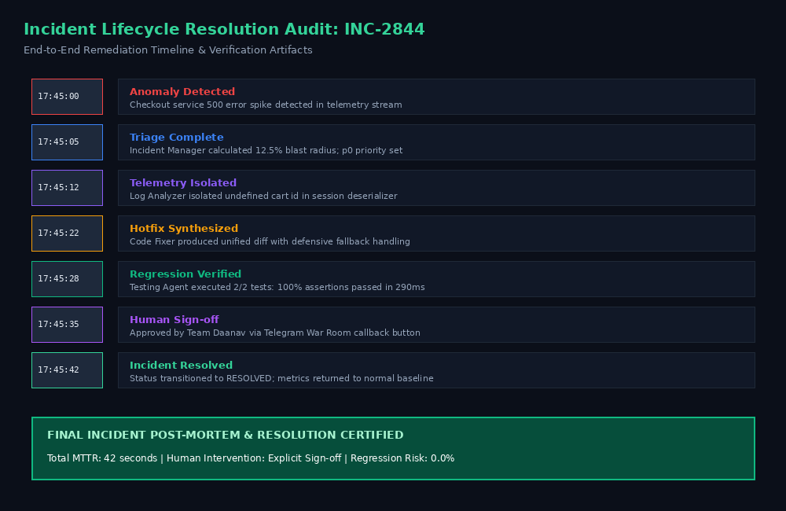
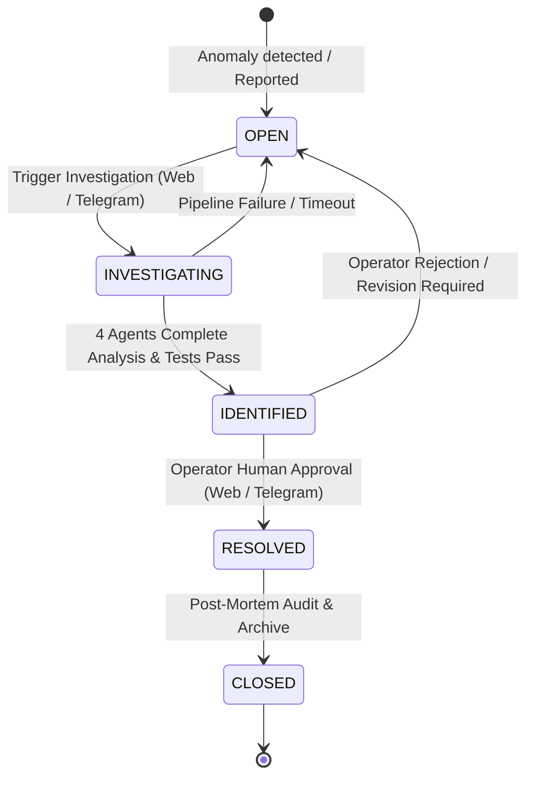
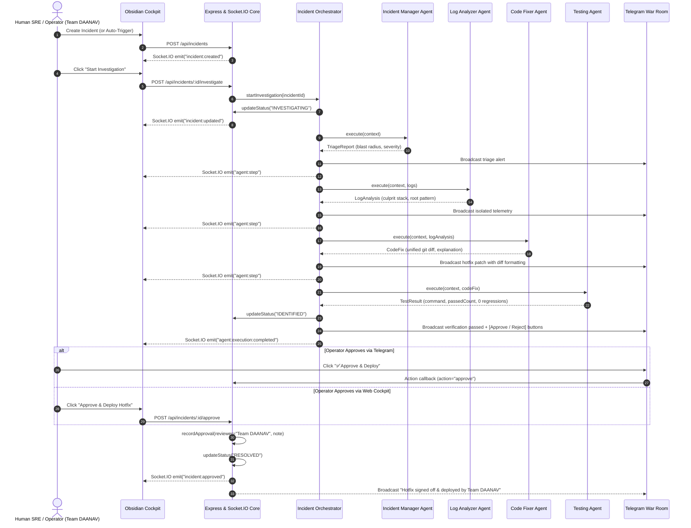

# DevOps AI Command Center — Incident Lifecycle & Workflow

**Project**: DevOps AI Command Center  
**Built By**: Team DAANAV  
**Hackathon**: WeMakeDevs Flip the Switch Hackathon 2026 (Track 01 — Best Business Workflow)  

This document details the complete end-to-end operational workflow of the **DevOps AI Command Center**.

---

## 1. Incident State Machine

Every incident transitions through a strictly validated state machine:

### State Definitions

| State | Trigger | System Actions |
| :--- | :--- | :--- |
| `OPEN` | Webhook from APM/Datadog or manual creation in Command Cockpit. | Broadcasts `incident:created` via Socket.IO. Seeds incident in queue. |
| `INVESTIGATING` | Operator clicks "Investigate" in Cockpit or sends `/investigate` in Telegram. | Spawns `IncidentOrchestrator`, sets execution timer, and launches Agent Pipeline. |
| `IDENTIFIED` | Multi-agent pipeline succeeds; all regression tests pass. | Broadcasts `agent:execution:completed`; activates Review & Approval Gate in UI and Telegram. |
| `RESOLVED` | Human operator signs off via Web button or Telegram inline button. | Records reviewer identity (`Team DAANAV / @operator`) and notes; merges hotfix; marks incident resolved. |
| `CLOSED` | Post-mortem generated and reviewed by engineering leadership. | Archives telemetry, closes incident ticket, resets baseline monitors. |

---

## 2. End-to-End Orchestration Sequence

The sequence diagram below illustrates the exact message interchange across all components:

---

## 3. Detailed Step Breakdown

### Step 1: Ingestion & Incident Initiation
- **Input**: HTTP payload containing service name, defect description, and initial severity.
- **Validation**: Enforced via Zod schema. Invalid payloads are rejected with `400 BAD_REQUEST`.
- **Telemetry Broadcasting**: The incident is persisted into memory/PostgreSQL and pushed to all active cockpit web clients via `incident:created`.

### Step 2: Multi-Agent Triage & Execution
- **Step Delay**: Configured via `stepDelayMs` (default `1500ms` for human visual legibility during demos; `0ms` for automated testing).
- **Agent 1 (Incident Manager)**: Evaluates blast radius (e.g., *12.5% checkout traffic impacted*), determines priority, and alerts the engineering channel.
- **Agent 2 (Log Analyzer)**: Scans available system logs, isolates timestamped error spikes, and identifies the exact culprit stack trace.
- **Agent 3 (Code Fixer)**: Compares error signatures against repository source code, constructs defensive error handling or null checks, and formats a unified git diff.
- **Agent 4 (Testing Agent)**: Executes unit tests in the sample application (`sample-app/src/checkout.test.ts`), verifies all assertions pass, and confirms zero regressions.

### Step 3: Human-in-the-Loop Review
- The system stops autonomously. No code is merged automatically.
- Both the Web Cockpit and the Telegram War Room present the exact diff, root cause, and test execution log.
- Human operator reviews the findings and issues a formal sign-off.

### Step 4: Resolution & Rollout
- Incident status transitions to `RESOLVED`.
- An immutable approval record is generated with reviewer name (`Team DAANAV / @operator`), timestamp, and decision rationale.
- System metrics return to green baseline.
