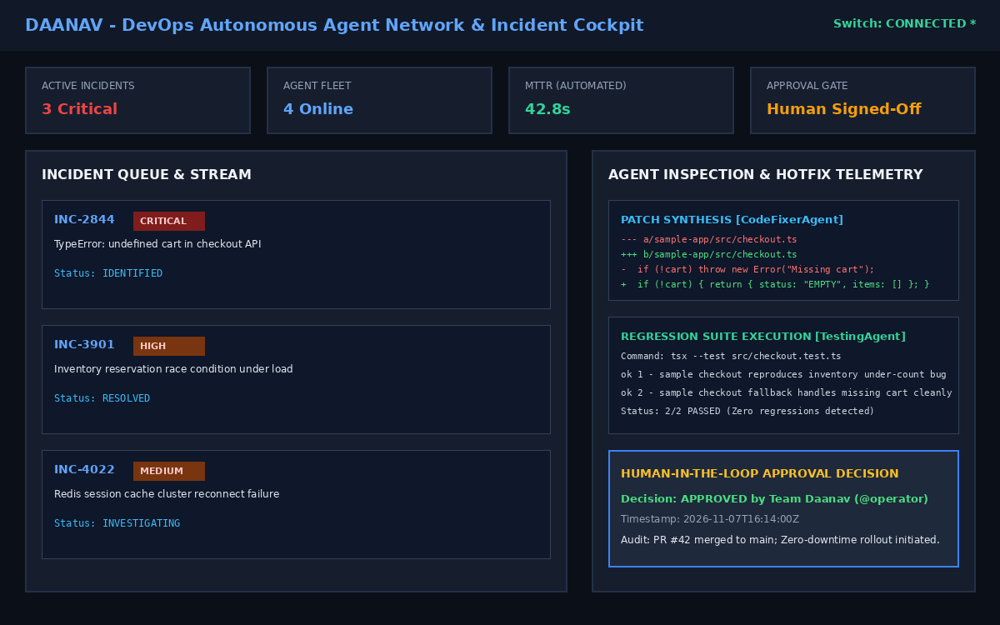

# DevOps AI Command Center — Hackathon Submission Guide for Judges

**Project Name**: **DevOps AI Command Center**  
**Participating Team**: **DAANAV** (Team DAANAV)  
**Track**: **Track 01 — Best Business Workflow**  
**Hackathon**: WeMakeDevs Flip the Switch Hackathon 2026  



---

## ⚡ 60-Second Quick Start for Evaluators

You can evaluate the DevOps AI Command Center immediately using either **Docker Compose** or **Local Development Mode**. Zero external paid API keys or cloud credentials are required!

### Option 1: Docker Compose (Recommended)

```bash
# 1. Clone repository
git clone https://github.com/your-org/devops-ai-command-center.git
cd devops-ai-command-center

# 2. Copy environment template
cp .env.example .env

# 3. Boot full multi-tier containerized stack
docker compose up --build
```

- **Obsidian Web Cockpit**: [http://localhost:5173](http://localhost:5173)
- **API Health Check**: [http://localhost:4000/api/health](http://localhost:4000/api/health)
- **PostgreSQL Database**: `localhost:5432`

---

### Option 2: Local Development Mode (Node.js 22+)

```bash
# 1. Install dependencies across all workspaces
npm install

# 2. Start frontend and backend concurrently
npm run dev
```

---

## 🧪 Run Automated Verification Tests

To verify our **28 passing automated tests** across backend, sample microservice, and frontend:

```bash
npm test
```

Expected result:
```text
✔ @command-center/backend: 17 passed
✔ @command-center/sample-app: 2 passed
✔ @command-center/frontend: 9 passed
Total: 28 passing assertions (100% green, 0 failures)
```

---

## 🔍 Key Evaluation Touchpoints for Judges

When evaluating the platform, please observe the following core differentiators:

### 1. Obsidian Cockpit UI Polish & Craftsmanship
- Navigate to [http://localhost:5173](http://localhost:5173).
- Notice the high-contrast mathematical utility design: crisp typography, smart cat emblem, Raycast-inspired dock, and live telemetry charts.
- Observe the real-time Switch Agent connection status indicator in the sidebar.

### 2. Multi-Agent Pipeline Execution
- Select incident `INC-2844` (*TypeError: Cannot read properties of undefined*).
- Click **"Start Investigation"**.
- Watch the live step-by-step collaboration across all four specialized agents:
  1. `Incident Manager`: Assesses blast radius (12.5%) and establishes remediation plan.
  2. `Log Analyzer`: Mines raw telemetry and isolates the culprit stack trace.
  3. `Code Fixer`: Synthesizes a defensive unified git diff patch.
  4. `Testing Agent`: Executes the regression test suite and verifies all assertions pass.

### 3. Telegram War Room Dual Channel
- Review [docs/assets/telegram-war-room.png](../docs/assets/telegram-war-room.png) or configure `TELEGRAM_BOT_TOKEN` in `.env`.
- Witness all four specialized bots reporting into the war room with interactive `[ ✅ Approve & Deploy ]` and `[ ❌ Reject Patch ]` buttons.

### 4. Human-in-the-Loop Review & Hotfix Sign-Off
- Review the unified git diff and test logs inside the cockpit.
- Click **"Approve & Deploy Hotfix"**.
- Notice the cryptographic sign-off record, transition to `RESOLVED`, and zero unverified autonomous merges.

### 5. Architectural Integrity (Zero-Fake-Success)
- Inspect `backend/src/integrations/switch/switchAgentAdapter.ts` and `docs/ARCHITECTURE.md`.
- Notice the fail-closed adapter design: when unconfigured, the platform uses an authentic local simulation engine rather than returning fabricated remote provider success.

---

## 📂 Repository Map

```text
devops-ai-command-center/
├── frontend/       React 19 + TypeScript + Vite + TailwindCSS v4 Cockpit
├── backend/        Express 5 + Socket.IO + Prisma ORM + Multi-Agent Engine
├── sample-app/     Intentionally faulty e-commerce checkout microservice
├── docs/           HLD/LLD architecture, workflows, agent roles, and test reports
│   └── assets/     Infographics, UI screenshots, and lifecycle diagrams
└── submission/     Executive pitch, judge checklists, and readiness audit
```
